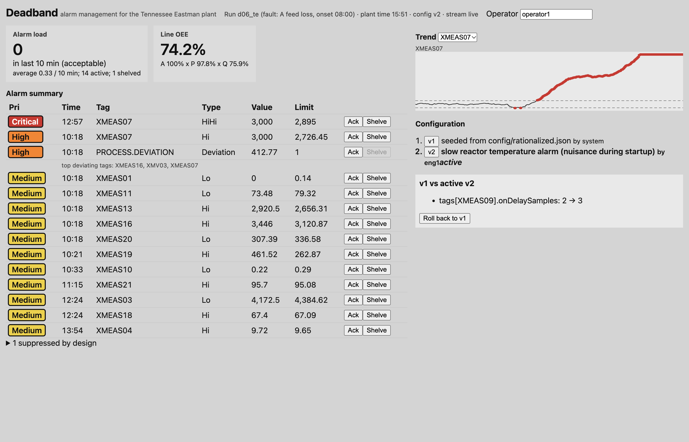

# Deadband

I built an alarm-management web app for a process plant: an ASP.NET Core Web API (C#, .NET 8) that runs an ISA-18.2 style
alarm engine on a live tag stream, and an Angular HMI on top of it. The plant is the Tennessee Eastman Process, the
standard public chemical-plant benchmark with 21 labeled faults, replayed tag by tag from the real data files. The question
I wanted to answer: how much of an operator's alarm load can good alarm engineering remove without going blind to real
faults?



## What it does

- **Alarm engine** (`src/Deadband.Core/Alarms`): HI/LO/HIHI/LOLO limits with deadband (hysteresis) and on/off delays,
  operator shelving that requires a user and a reason and expires on its own, chattering-alarm suppression, and flood
  detection that raises one consolidated alarm with the first-out tag and holds back low-priority alarms during the flood.
  Everything lands in an alarm journal, so shelving and suppression are auditable.
- **Fault detection** (`src/Deadband.Core/Detection`): a PCA monitor (Hotelling T2 + SPE) fitted on normal operation,
  EWMA-filtered, raised as one `PROCESS.DEVIATION` alarm that names the three most deviating tags. The sampled analyzers and
  controller outputs are covered by this alarm instead of 30 separate limit alarms.
- **Configuration as code** (`src/Deadband.Core/Config`, `config/`): alarm configuration is a JSON file. A validator
  catches limit-order mistakes, deadbands that could never clear, unknown tags and alarms with no written rationale. The
  store is append-only: every publish writes an immutable version with a SHA-256, rollback re-publishes an old version as a
  new one, and diffs are keyed by tag rather than array position. CI runs `deadband validate config/*.json` as a gate.
- **Web API** (`src/Deadband.Api`): versioned REST under `/api/v1` (Asp.Versioning), OpenAPI at `/swagger`, EF Core +
  SQLite journal, a Server-Sent Events stream at `/api/v1/alarms/stream`, and config publish/diff/rollback that hot-swaps
  the running engine.
- **HMI** (`web/`, Angular 22): grey ISA-101 style screen where color only means priority, alarm summary with ack and
  reason-required shelving, a "suppressed by design" list so nothing is silently hidden, trends with limit lines,
  alarm-load and OEE tiles, and configuration history with a diff view and two-step rollback.
- **OEE**: availability x performance x quality adapted to a continuous process (running = product flow above half of
  design rate; performance = output vs design rate; quality = product analyzers inside a spec band).

## Results

All numbers come from `results/results.json`, produced by `scripts/reproduce.sh`. Test data: the 22 held-out TEP test runs
(48 h each, fault introduced at hour 8), 1,056 h in total, of which 216 h are normal operation. Parameters were tuned on
the training files only (selected: limits at mean +/- 4 sigma, deadband 0.5 sigma, on-delay 2 samples, PCA at 99% with
10 components, EWMA 0.2), then the test files were run once.

| Configuration | Alarms / operator / 10 min | Peak in 10 min | 10-min windows in flood | False alarms in 216 h normal | Faults alarmed within 2 h (of 21) | Median delay (those) |
|---|---|---|---|---|---|---|
| As-found (3 sigma on all 52 tags, no deadband/delay) | 2.40 | 22 | 7.95% | 641 | 20 | 6 min |
| + rationalized limits, deadband, delays | 0.27 | 9 | 0% | 7 | 11 | 21 min |
| + PCA `PROCESS.DEVIATION` alarm | 0.28 | 9 | 0% | 11 | 16 | 19.5 min |
| + chatter suppression + flood handling (full) | **0.27** | **8** | **0%** | **11** | **16** | **19.5 min** |

- Annunciated alarm rate drops 88.6% (2.40 to 0.27 per 10 min) and normal-operation false alarms drop 98.3% (641 to 11).
- The as-found system "detects" 20 faults within 2 h only because it alarms about three times an hour on normal data: a
  pure false-alarm process at its rate would be expected to produce 7.35 of its 21 first-alarm detections by chance, versus
  2.01 for the rationalized system (`expectedChanceDetections`).
- The multivariate alarm is what keeps detection up: limits alone catch 11 faults within 2 h, adding the PCA alarm raises it
  to 16.
- Missed within 2 h: faults 3, 15, 18, 20 and 21. Faults 3 and 15 (and 9) are known in the TEP literature to be nearly
  invisible to this kind of monitor; 21 is a slow valve drift that shows up after about 13 h.

API load test on one laptop (Apple Silicon, client and server on the same machine, Release build, 32 concurrent workers
for 20 s, mixed reads of active alarms, alarm history, tag snapshot and KPIs, 302,680-row journal):

| Journal | Requests | p50 | p95 | p99 | Req/s | Errors |
|---|---|---|---|---|---|---|
| With (Tag, TimeSec) index | 1,074,977 | 0.46 ms | **1.32 ms** | 3.28 ms | 53,689 | 0 |
| Without the index (baseline) | 13,971 | 9.25 ms | 205.77 ms | 284.38 ms | 696 | 0 |

Tests: 50 .NET tests (xUnit unit tests + `WebApplicationFactory` integration tests that drive the real API, SQLite journal,
SSE stream and config rollback) and 13 Angular component/service tests (Vitest), all passing locally. GitHub Actions runs
the config lint, both test suites, the Angular build and the full benchmark on every push.

## Run it

Requirements: .NET 8 SDK, Node 22+.

```bash
# API + live replay of fault 6 (A feed loss) using the bundled fixture data
dotnet run --project src/Deadband.Api --urls http://127.0.0.1:5080
# Swagger: http://127.0.0.1:5080/swagger

# Angular HMI (proxies /api to the API)
cd web && npm ci && npx ng serve        # http://localhost:4200
# or build it once and the API serves it at http://127.0.0.1:5080/
cd web && npx ng build

# tests
dotnet test Deadband.sln
cd web && npx ng test --watch=false

# full benchmark + load test + test counts -> results/results.json (downloads ~25 MB of TEP data)
scripts/reproduce.sh
```

Useful endpoints: `GET /api/v1/alarms/active`, `GET /api/v1/alarms/history?tag=XMEAS09`, `POST /api/v1/alarms/{tag}/shelve`,
`GET /api/v1/alarms/stream` (SSE), `GET /api/v1/kpi/alarm-load`, `GET /api/v1/kpi/oee`, `POST /api/v1/config/versions`,
`GET /api/v1/config/diff?from=1&to=2`, `POST /api/v1/config/rollback/1`, `POST /api/v1/replay {"run":"d12_te"}`.

The repo ships three data files as fixtures (`data/tep/`: normal training, normal test, fault 6). `scripts/get-data.sh`
downloads the rest.

## Honest limits

- One operator for the whole plant is assumed when quoting "per operator" rates.
- The 2-hour detection window is my operational choice; over the whole 40 h after onset every configuration alarms on all
  21 runs, which mostly reflects false alarms for faults 3, 9 and 15. Fault 9 is "caught" in 18 min by the rationalized
  system, which is probably a chance alarm given that fault's history in the literature.
- Rationalization here is statistical plus five operating limits from Downs and Vogel; a real rationalization uses
  consequence and operator-response-time reviews with plant engineers.
- The flood layer never triggered on the test set after the other layers (peak 8 in 10 min), so its effect is only shown
  by the unit tests, not by the benchmark.
- OEE on a continuous chemical process is an adaptation (availability is 100% in every run because the Braatz data has no
  shutdowns; the quality band of +/- 1.5 mol% on product G and H is my assumption).
- Publishing a new configuration rebuilds the engine, so alarms that are still active re-annunciate once.
- Load-test numbers are from one laptop with client and server sharing the CPU; they show the relative effect of the index,
  not production capacity. The no-index run also slows unrelated endpoints because slow queries tie up the thread pool.
- The data stream is a replay of recorded data, not an OPC UA or FactoryTalk connection.
